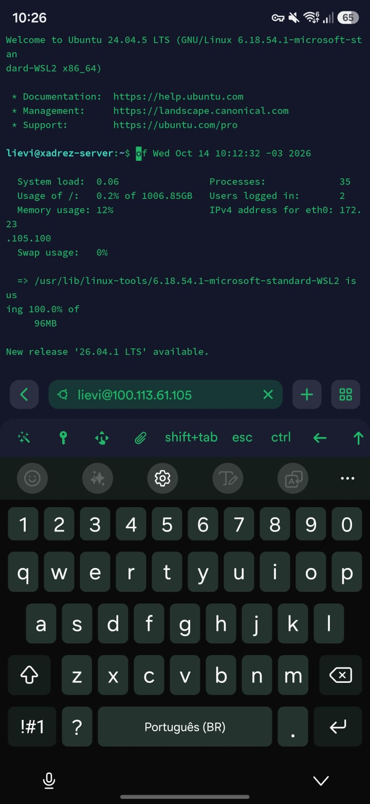
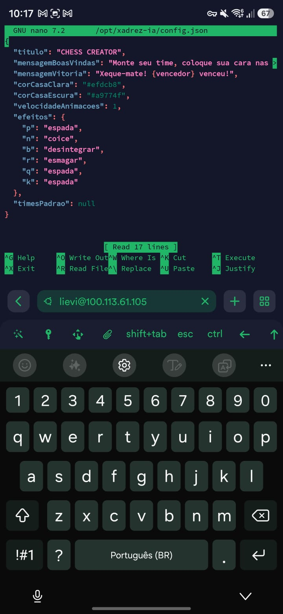
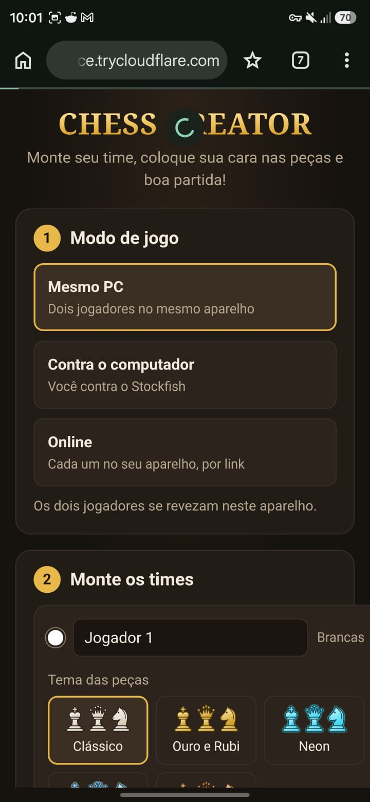

# CHESS CREATOR

Jogo de xadrez no navegador com três modos (mesmo PC, contra o computador e online), peças personalizadas com personagens ou com fotos transformadas por IA, e animações de captura (espada, esmagamento, coice, feitiço; no xeque-mate o rei explode).

Trabalho bimestral de **Infraestrutura de Servidores** (Prof. Lucca Abbado Neres — FAG): o jogo roda num computador Linux que faz o papel de servidor e é publicado na Web com **Cloudflare Tunnel**.

## 1. Integrantes

| Nome | Função |
|---|---|
| Nicoli Lievi Ackermann Coelho | 
| Guilherme Pereira |
| Isabella Bonet | 
| João Dal Molin | 

## 2. O serviço

- **Modos de jogo:**
  - **Mesmo PC:** dois jogadores se revezam no mesmo aparelho.
  - **Contra o computador:** Stockfish 19 (versão "lite", uma thread) rodando no navegador, em 3 níveis: **Fácil (rating 1320)**, **Médio (rating 1800)** e **Difícil (força máxima, acima de 3190)**. O rating é aplicado pela opção `UCI_Elo` do próprio Stockfish, calibrada por ele numa escala de 1320 a 3190 (escala de motores, ancorada na lista CCRL; não é o rating FIDE nem o do Chess.com).
  - **Online:** quem cria a sala recebe um código de 4 letras, um link e um QR code; o adversário entra de outro aparelho, em qualquer rede. O servidor confere cada jogada com o chess.js (ninguém consegue mandar jogada ilegal ou fora da vez).
- **Temas:** Clássico, Ouro e Rubi, Neon, Gelo e Fogo, Madeira.
- **Peças personalizadas** (botão "Colocar fotos nas peças"):
  - **Personagem:** o busto do personagem sai de um pedestal de xadrez com um medalhão que mostra o tipo da peça. Instantâneo, funciona sem internet e com personagens famosos.
  - **Foto de pessoa:** a IA do Cloudflare desenha a peça com a cabeça da pessoa.
- **Times guardados no servidor:** o botão "Guardar estes times no servidor" mostra um trecho para colar no `config.json` (campo `timesPadrao`). Qualquer aparelho que abrir o jogo pela primeira vez começa com esses times, mesmo depois que a URL do túnel muda.
- **Animações de captura** (dependem de quem captura; trocáveis no `config.json`):

  | Quem captura | Efeito |
  |---|---|
  | Peão, Rei, Rainha | `espada`: corte na diagonal, a peça se parte em duas |
  | Torre | `esmagar`: cai em cima e achata a vítima |
  | Cavalo | `coice`: arremessa a vítima para fora do tabuleiro |
  | Bispo | `desintegrar`: feitiço que transforma a vítima em cinzas |

- **Página de teste:** `/teste-animacoes.html` roda cada efeito com controle de velocidade.

## 3–6. Servidor, tecnologias, comando e porta

| Item | Valor |
|---|---|
| Sistema operacional | **Ubuntu 24.04.5 LTS** rodando no **WSL 2** (kernel `6.18.40.1-microsoft-standard-WSL2`, systemd ativo) num notebook com Windows 10. Hostname `xadrez-server` |
| Tecnologias | Node.js + Express, Socket.IO, chess.js, Stockfish (WASM), HTML/CSS/JS puro, Web Animations API, Web Audio API, Cloudflare Workers AI, systemd, Cloudflare Tunnel, Tailscale |
| Comando para iniciar | `sudo systemctl start xadrez` (o serviço executa `node server.js` em `/opt/xadrez-ia`) |
| Porta | **3000** (variável `PORT` no `.env`) |

Caminho de uma requisição:

```
navegador (celular no 4G) → Cloudflare → cloudflared (serviço xadrez-tunel) → http://localhost:3000 → node server.js (serviço xadrez)
```

## Instalação passo a passo

O `deploy/instalar.sh` monta o servidor inteiro com um comando. Ele:

1. instala os pacotes do sistema (`curl`, `git`, `tmux`, `ufw`, `openssh-server`);
2. instala o Node.js (versão LTS), o `cloudflared` e o Tailscale, se ainda não existirem;
3. deixa o `sshd` escutando direto na porta 22 (desliga o `ssh.socket` do Ubuntu 24.04);
4. cria o usuário de sistema `xadrez` (que roda o jogo) e o grupo `xadrez` (quem pode editar o jogo) e coloca quem rodou o script nesse grupo;
5. copia o projeto para `/opt/xadrez-ia` (sem `node_modules` e sem `data`, então as peças já criadas no servidor não se perdem);
6. cria o `.env` a partir do `.env.example`, se não existir;
7. instala as dependências (`npm ci`) e acerta as permissões (`.env` fica 640);
8. instala e habilita os serviços `xadrez` (o jogo) e `xadrez-tunel` (o Cloudflare Tunnel) e reinicia o jogo;
9. testa com `curl` e `ss` e mostra o resultado.

Precisa de internet e de `sudo`. Leva de 2 a 5 minutos na primeira vez. Pode ser rodado de novo quantas vezes quiser: é assim que se atualiza o jogo.

### Caminho A: notebook com Windows (WSL 2), que é o nosso caso

O grupo só tinha um notebook com Windows, então o servidor Linux é um Ubuntu de verdade rodando no WSL 2 (uma máquina virtual leve do Windows, com kernel Linux e systemd próprios).

**Passo 1. Instalar o Ubuntu.** No PowerShell do Windows:

```powershell
wsl --install -d Ubuntu-24.04
```

Na primeira vez que o Ubuntu abrir, ele pede um nome de usuário e uma senha (o nosso é `lievi`). Nada aparece enquanto a senha é digitada; é normal. Se a instalação der o erro `0x8000000d`, uma instalação anterior ficou pela metade: `wsl --unregister Ubuntu-24.04` e instale de novo.

**Passo 2. Ligar o systemd e dar nome à máquina.** No terminal do Ubuntu:

```bash
sudo nano /etc/wsl.conf
```

Conteúdo do arquivo:

```ini
[boot]
systemd=true
[user]
default=lievi
[network]
hostname=xadrez-server
generateHosts=true
```

Salvar (<kbd>Ctrl+O</kbd>, <kbd>Enter</kbd>, <kbd>Ctrl+X</kbd>). Depois, no PowerShell, reiniciar o Ubuntu para valer e abrir de novo:

```powershell
wsl --shutdown
wsl -d Ubuntu-24.04
```

Conferir: `hostname` tem que mostrar `xadrez-server` e `ps -p 1 -o comm=` tem que mostrar `systemd`.

**Passo 3. Rodar o instalador.** O Ubuntu enxerga o disco do Windows em `/mnt/c`, então não precisa copiar nada:

```bash
cd /mnt/c/Users/lievi/Desktop/xadrez-ia
sudo bash deploy/instalar.sh
```

O final tem que mostrar `curl http://127.0.0.1:3000/  ->  HTTP 200` e as linhas do `node` na 3000 e do `sshd` na 22. Se a pasta do Windows tiver um `.env` (com o token da IA), ele é copiado junto; se não tiver, o jogo funciona sem a IA de fotos.

**Passo 4. Senha do SSH.** Se o usuário foi criado sem senha, criar uma (no PowerShell):

```powershell
wsl -d Ubuntu-24.04 -u root passwd lievi
```

**Passo 5. Tailscale (uma vez).** No Ubuntu:

```bash
sudo tailscale up --hostname=xadrez-server
```

Abrir o link que aparecer e entrar com uma **conta pessoal** (Gmail). A conta da faculdade cai numa rede compartilhada com outros alunos da FAG. Depois, `tailscale ip -4` mostra o IP 100.x do servidor.

**Passo 6. URL pública.**

```bash
bash /opt/xadrez-ia/deploy/tunel.sh
```

**Passo 7. Manter ligado.** No Windows, dois cliques em `ligar-servidor-wsl.bat` (na pasta do projeto). Sem ele, o WSL desliga o Ubuntu alguns minutos depois que o último terminal é fechado, e o site cai junto. Deixar o notebook na tomada e sem suspender.

**Passo 8. Conferir tudo:**

```bash
systemctl is-active xadrez xadrez-tunel ssh     # active, active, active
sudo ss -lntp | grep -E ':(3000|22) '
curl -i http://127.0.0.1:3000/
```

**Detalhes do WSL que mudam o que aparece nos comandos:**
- `ip -br addr` mostra `eth0` com **172.23.x.x**: é a rede virtual entre o Ubuntu e o Windows. O Windows faz NAT para o Wi-Fi, por isso `ip route` mostra `default via 172.23.96.1` (o Windows), não o roteador. O IP do Wi-Fi fica no Windows (`ipconfig`).
- `uptime` é o tempo desde que a máquina virtual do Ubuntu ligou, não o do Windows.
- O WSL desliga o Ubuntu quando nenhum programa `wsl.exe` está aberto, mesmo com os serviços rodando. Por isso existe o **`ligar-servidor-wsl.bat`** (dois cliques antes de apresentar): ele deixa um `wsl.exe` escondido rodando `sleep infinity`, mostra o estado dos serviços e a URL pública.
- Outro computador da rede local não alcança o IP 172.23.x.x (NAT). O acesso administrativo de fora é pelo **Tailscale** (`tailscale0`, 100.113.61.105).

### Caminho B: computador com Ubuntu 24.04 instalado direto (sem Windows)

**Passo 1. Levar o projeto para o servidor.** No PowerShell do Windows (troque `usuario` e o IP do servidor):

```powershell
tar -czf "$env:USERPROFILE\Desktop\xadrez-ia.tar.gz" --exclude=node_modules --exclude=data --exclude=.claude -C "$env:USERPROFILE\Desktop" xadrez-ia
scp "$env:USERPROFILE\Desktop\xadrez-ia.tar.gz" usuario@192.168.0.50:~/
```

(ou copiar por pendrive). O pacote inclui o `.env` com o token da IA: não compartilhe esse arquivo.

Outra opção é baixar do GitHub: `git clone https://github.com/Nlievi/chess-creator.git xadrez-ia`. O repositório não tem o `.env` (o token nunca vai para o Git); sem ele o jogo funciona, só o modo "Foto de pessoa" fica desligado até alguém criar o `.env` no servidor.

**Passo 2. Dar nome à máquina e rodar o instalador.** No servidor:

```bash
sudo hostnamectl set-hostname xadrez-server
tar -xzf xadrez-ia.tar.gz
cd xadrez-ia
sudo bash deploy/instalar.sh
```

**Passos 3 a 5.** Iguais aos passos 5, 6 e 8 do caminho A (Tailscale, `tunel.sh` e conferir). O `ligar-servidor-wsl.bat` não é necessário: numa máquina Linux de verdade os serviços sobem sozinhos quando ela liga.

### Contas dos integrantes

Para cada um entrar pelo SSH com o próprio usuário:

```bash
sudo adduser NOME
sudo usermod -aG sudo,xadrez,systemd-journal NOME
```

### Atualizar o jogo depois

Rodar o instalador de novo, do mesmo jeito do passo 3 (WSL) ou do passo 2 (Ubuntu). Ele reinicia o jogo, mas **não** reinicia o túnel, então a URL pública continua a mesma.

Atenção: o instalador copia a pasta do Windows **por cima** de `/opt/xadrez-ia`, inclusive o `config.json` e o `.env`. Se alguém mudou o `config.json` pelo SSH no servidor e quer manter, copie de volta antes (`cp /opt/xadrez-ia/config.json /mnt/c/Users/lievi/Desktop/xadrez-ia/`).

### Erros comuns na instalação

| Mensagem | Causa e solução |
|---|---|
| `Rode com sudo` | Faltou o `sudo` antes de `bash deploy/instalar.sh` |
| `System has not been booted with systemd` | O `systemd=true` do `/etc/wsl.conf` não foi aplicado: conferir o arquivo e rodar `wsl --shutdown` no PowerShell |
| `$'\r': command not found` | O script ficou com quebras de linha do Windows: `sed -i 's/\r$//' deploy/*.sh` e rodar de novo |
| `curl ... -> HTTP 000` no final | O jogo não subiu: `sudo journalctl -u xadrez -n 30` mostra o motivo (porta ocupada, `.env` ou `config.json` com erro) |
| `npm ci` ou `apt-get` falham | Sem internet, ou a rede bloqueia: testar `curl -I https://deb.nodesource.com` |

## Rodar no seu computador (desenvolvimento)

```bash
npm install
cp .env.example .env     # opcional: sem ele roda na porta 3000, sem a IA
npm run dev              # reinicia sozinho quando um arquivo .js do servidor muda
```

Abra `http://localhost:3000`.

## Estrutura

```
server.js            Express: site, /api/config, /api/status, /api/gerar, /api/pecas + limites de uso
salas.js             Modo online: salas com Socket.IO, jogadas conferidas com o chess.js
ia.js                Geração das peças com a IA do Cloudflare (Workers AI)
config.json          Textos, cores, animações e times padrão; lido a cada acesso (edite via SSH!)
.env                 Porta, endereço e chaves da IA (fora do Git)
deploy/instalar.sh   Instalação completa no Ubuntu
deploy/tunel.sh      Mostra a URL pública (e liga o túnel se estiver desligado)
deploy/xadrez.service, deploy/xadrez-tunel.service   Serviços do systemd
data/pecas/          Peças personalizadas (fora do Git)
public/
  index.html, css/style.css
  js/main.js          Telas, menus, modo online
  js/partida.js       Regras e turnos (chess.js) + chama as animações
  js/tabuleiro.js     Desenho do tabuleiro e das peças
  js/controladores.js Quem joga cada lado: local, bot (Stockfish) ou remoto (online)
  js/animacoes.js     Efeitos de captura e de xeque-mate
  js/particulas.js    Faíscas, poeira, cinzas
  js/sons.js          Sons sintetizados (sem arquivos de áudio)
  js/pecas.js         Peças em SVG e temas
  js/personalizar.js  Janela "Colocar fotos nas peças"
  js/recorte.js       Reduz a foto e remove o fundo
  js/personagem.js    Modo Personagem: busto num pedestal de xadrez com medalhão
  vendor/stockfish/   Stockfish 19 lite (licença GPL-3, ver LICENCA-GPL3.txt)
  teste-animacoes.html
```

## IA gratuita (Cloudflare Workers AI)

Sem configuração, o modo **Personagem** funciona normalmente (não usa IA) e o modo **Foto de pessoa** fica desativado. Para ativar:

1. Crie uma conta gratuita no Cloudflare.
2. No painel: **AI → Workers AI → Use REST API**. Copie o **Account ID** e crie um **API Token**.
3. Coloque os dois no `.env` do servidor (`sudo nano /opt/xadrez-ia/.env`) e reinicie: `sudo systemctl restart xadrez`.
4. O rodapé do site passa a mostrar `IA: cloudflare`.

Detalhes:
- Modelo `@cf/black-forest-labs/flux-2-klein-4b`, cerca de 7 segundos por peça. A cota grátis é diária (10.000 "neurons").
- Limites do servidor: 40 gerações por hora por pessoa (`IA_LIMITE_POR_HORA`) e 300 por dia no total (`IA_LIMITE_DIA`).
- Atrás do túnel toda requisição chega de 127.0.0.1; o IP real vem no cabeçalho `CF-Connecting-IP`, que só é aceito quando a conexão vem da própria máquina (o cloudflared). Quem acessa a porta 3000 direto não consegue inventar um IP.
- O filtro de conteúdo do Cloudflare **bloqueia personagens protegidos por direitos autorais** (testado com o Perna Longa). Para eles, use o modo Personagem.
- A chave fica só no servidor (`.env` com permissão 640) e nunca vai para o navegador nem para o Git.

## Demonstração: alteração remota por SSH (item 3.6)

```bash
ssh lievi@xadrez-server          # ou: ssh lievi@100.113.61.105 (IP do Tailscale)
nano /opt/xadrez-ia/config.json
```

Isso é feito de outro aparelho com o Tailscale ligado na mesma conta do servidor (notebook de um integrante ou celular com o app Termius). O `config.json` pode ser editado sem `sudo` porque o `lievi` está no grupo `xadrez`.

Exemplos: trocar `"mensagemBoasVindas"`, trocar `"r": "esmagar"` por `"r": "desintegrar"` (a torre passa a desintegrar), ou colar times novos em `"timesPadrao"`. Depois basta dar F5 no celular: o `config.json` é lido a cada acesso. Mudanças no `.env` ou em arquivos `.js` do servidor precisam de `sudo systemctl restart xadrez`.

### Teste feito em 14/10/2026 (itens 3.3 e 3.6)

Um celular Android com o Tailscale (mesma conta do servidor, IP `100.98.152.14`) e o app Termius entrou no servidor por SSH em `lievi@100.113.61.105`, porta 22. Na primeira conexão o Termius mostrou a impressão digital da chave do servidor, `SHA256:H33FUdKiIMele2UOSeHcwDrigNSjblN/l7wlxQzgiiA`, igual à do servidor (`ssh-keygen -lf /etc/ssh/ssh_host_ecdsa_key.pub`).

Log do servidor (`sudo journalctl -u ssh`):

```
10:12:32 sshd[913]: Accepted password for lievi from 100.98.152.14 port 34890 ssh2
```

Pelo mesmo SSH, o `config.json` foi editado no `nano` e salvo às 10:22:27. Sem reiniciar nada, a URL pública passou a entregar a mensagem nova:

```
$ curl https://capacity-muslim-cotton-balance.trycloudflare.com/api/config
{"titulo":"CHESS CREATOR","mensagemBoasVindas":"alterado por ssh pelo celular", ...}
```

<p>


</p>

Depois do teste, o `config.json` original foi restaurado.

## Diagnóstico de problemas (item 3.7)

A ordem de raciocínio é sempre: **o processo existe? → a porta está em escuta? → responde localmente? → só então o acesso externo.**

| Sintoma | Como diagnosticar | Como resolver |
|---|---|---|
| Processo parado | `systemctl status xadrez` mostra *inactive*; `sudo ss -lntp \| grep 3000` não mostra nada; `curl` local dá *connection refused*; a URL pública dá erro 502 do Cloudflare e o log do túnel mostra `dial tcp 127.0.0.1:3000: connect: connection refused` | `sudo systemctl start xadrez`. Obs.: se o processo morrer por erro (ou `kill -9`), o systemd o reinicia sozinho em 2 s (`Restart=on-failure`); `systemctl stop` e `kill` normal deixam parado |
| Porta diferente | `sudo ss -lntp` mostra outra porta (ex.: 3001); a URL pública dá 502 porque o túnel aponta para a 3000; `sudo journalctl -u xadrez -n 5` mostra "rodando em http://0.0.0.0:3001" | Corrigir `PORT` no `.env` (`sudo nano /opt/xadrez-ia/.env`) e `sudo systemctl restart xadrez` |
| Só em 127.0.0.1 | `sudo ss -lntp` mostra `127.0.0.1:3000` em vez de `0.0.0.0:3000`. O túnel **continua funcionando** (o cloudflared está na mesma máquina e entra pela loopback), mas quem vem pela rede não: no Windows, `curl.exe -m 5 http://172.23.105.100:3000/` falha, e pelo Tailscale `http://100.113.61.105:3000` também (`http://localhost:3000` no Windows continua abrindo, porque o WSL repassa o localhost pela loopback: não serve de teste) | `HOST=0.0.0.0` no `.env` + `sudo systemctl restart xadrez` |
| cloudflared encerrado | A URL pública para de abrir (erro 530/1033 do Cloudflare), mas `curl -i http://127.0.0.1:3000/` funciona; `systemctl status xadrez-tunel` mostra *inactive* | `bash /opt/xadrez-ia/deploy/tunel.sh` (a URL **muda**) |
| SSH parado | `ssh` dá *connection refused*; no terminal do próprio servidor (Ubuntu aberto no notebook): `systemctl status ssh` e `sudo ss -lntp \| grep ':22'` | `sudo systemctl start ssh` |
| Firewall | O ufw está instalado e **desligado**. Testado com `sudo ufw allow 22/tcp && sudo ufw enable`: no servidor `curl 127.0.0.1:3000` → 200 e a URL pública continua (o cloudflared só faz saída e fala com o jogo pela loopback), mas do Windows `curl.exe -m 5 http://172.23.105.100:3000/` dá *timeout* (pacote descartado), não *refused*. `sudo ufw status verbose` mostra `deny (incoming)` e só a 22 liberada. O ufw **não** bloqueia o Tailscale: a regra `ts-input` do Tailscale vem antes e aceita tudo da `tailscale0` (`sudo iptables -S INPUT`) | `sudo ufw allow 3000/tcp` (o `curl.exe` volta a dar 200); ao terminar a demonstração, `sudo ufw disable` |
| `config.json` quebrado | O site mostra o aviso "config.json inválido" com a linha do erro; `sudo journalctl -u xadrez` | Corrigir o JSON (vírgulas e aspas) |

**Por que não precisa abrir porta no roteador?** O `cloudflared` faz uma conexão de **saída** até o Cloudflare e as requisições voltam por ela. Nenhuma conexão de entrada chega ao roteador.

## 7–13. Evidências

Saídas reais do servidor em 14/10/2026 (os prints ficam em `docs/evidencias/`).

**Identificação da máquina (item 3.1):**

```
$ hostname
xadrez-server
$ whoami
lievi
$ ip -br addr
lo               UNKNOWN        127.0.0.1/8 ::1/128
eth0             UP             172.23.105.100/20 fe80::215:5dff:fe39:3cca/64
tailscale0       UNKNOWN        100.113.61.105/32 fd7a:115c:a1e0::de01:3dec/128 fe80::3d92:b034:b24f:87ee/64
$ ip route
default via 172.23.96.1 dev eth0 proto kernel onlink
172.23.96.0/20 dev eth0 proto kernel scope link src 172.23.105.100
$ uptime
 08:24:54 up 34 min,  2 users,  load average: 0.03, 0.08, 0.08
```

**7. `sudo ss -lntp` mostrando a porta:**

```
State  Recv-Q Send-Q   Local Address:Port           Peer Address:Port Process
LISTEN 0      4096     100.113.61.105%tailscale0:51767   0.0.0.0:*    users:(("tailscaled",pid=206,fd=25))
LISTEN 0      4096     127.0.0.1:20241                   0.0.0.0:*    users:(("cloudflared",pid=211,fd=9))
LISTEN 0      511      0.0.0.0:3000                      0.0.0.0:*    users:(("node",pid=1788,fd=21))
LISTEN 0      128      0.0.0.0:22                        0.0.0.0:*    users:(("sshd",pid=231,fd=3))
LISTEN 0      128      [::]:22                              [::]:*    users:(("sshd",pid=231,fd=4))
```

O jogo é o `node` na **3000** (em `0.0.0.0`, todas as interfaces) e o SSH é o `sshd` na **22**. A 20241 é a página de métricas do cloudflared (só na loopback) e a 51767 é do Tailscale (só na interface `tailscale0`).

**8. Teste local com `curl`:**

```
$ curl -i http://127.0.0.1:3000/
HTTP/1.1 200 OK
X-Powered-By: Express
Content-Type: text/html; charset=utf-8
Content-Length: 7080
```

**9. Comando do Cloudflare Tunnel** (é o `ExecStart` do serviço `xadrez-tunel`, ver `deploy/xadrez-tunel.service`):

```
cloudflared tunnel --no-autoupdate --url http://localhost:3000
```

**10. URL `trycloudflare.com`** (saída de `bash /opt/xadrez-ia/deploy/tunel.sh`; ela muda sempre que o túnel reinicia):

```
https://capacity-muslim-cotton-balance.trycloudflare.com
```

Log do túnel: `Registered tunnel connection connIndex=0 ... location=gru02 protocol=quic` (conectado ao Cloudflare de São Paulo).

A URL também aparece na barra de endereço do print do item 11.

**11. Acesso a partir de outra rede:**

Celular na rede móvel (a barra de status não tem o ícone de Wi-Fi, só o sinal da operadora) abrindo `https://capacity-muslim-cotton-balance.trycloudflare.com` em 14/10 às 10:05, enquanto o servidor estava no Wi-Fi da FAG. No mesmo minuto, o log do servidor (`sudo journalctl -u xadrez`) registrou os acessos chegando pelo túnel: `10:05:03 GET / -> 200`, `10:05:06 GET /api/config -> 200`.



**12. Um problema encontrado e como foi diagnosticado:**

Depois da instalação, minutos após fecharmos o terminal do Ubuntu, a URL pública passou a responder **HTTP 530 (Error 1033)** do Cloudflare: o Cloudflare não encontrava mais o túnel. Seguimos a ordem de diagnóstico começando pelo primeiro passo, "o processo existe?": no Windows, `wsl -l -v` mostrou o Ubuntu como **Stopped**. Ou seja, a máquina Linux inteira estava desligada: sem o processo do jogo, sem a porta 3000 e sem o cloudflared. Causa: o WSL desliga a máquina virtual quando nenhum programa `wsl.exe` está aberto, mesmo com serviços do systemd ativos. Solução: o `ligar-servidor-wsl.bat` mantém um `wsl.exe` escondido rodando `sleep infinity`; com ele, `wsl -l -v` passou a mostrar **Running** e a URL voltou a responder 200.

O mesmo sintoma voltou em 14/10, mesmo com o `sleep infinity` rodando: a URL parou de existir (o nome nem resolvia mais). `wsl -l -v` mostrou **Stopped** de novo; `last -x shutdown` no Ubuntu mostrou que ele desligou às 09:37; e `uname -r` mostrou um kernel diferente do da manhã (`6.18.40.1` → `6.18.54.1`). Causa: a Microsoft Store atualizou o WSL sozinha, e a atualização desliga todas as máquinas Linux. Solução: rodar o `ligar-servidor-wsl.bat` de novo (os serviços sobem sozinhos pelo systemd; a URL do túnel muda) e desligar as atualizações automáticas da Store até a apresentação.

**13. Repositório:** https://github.com/Nlievi/chess-creator
